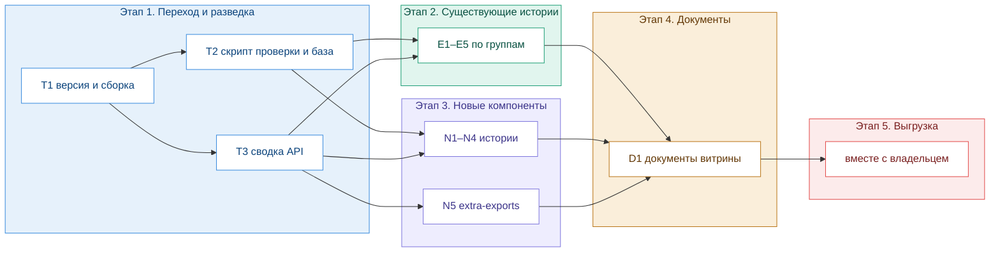

# 001 — переход витрины на @moysklad/uikit 31.20.0: план

Контекст, решения по объёму и ловушки — в `00-context.md`. Этапы 1–4 ведёт оркестратор, этап 5 — основная сессия вместе с владельцем.

Этапы 2 и 3 не пересекаются по файлам и могут идти вперемешку в пределах ширины параллели.

## Общие проверки

Используются в критериях ниже под этими именами.

- **`types`** — `npx tsc --noEmit` завершается с кодом 0.
- **`build`** — `npm run build-storybook` завершается с кодом 0.
- **`runtime <ids>`** — `npm run check-stories -- --ids <ids>` (скрипт из T2) завершается с кодом 0, и в его отчёте у этих историй ноль ошибок консоли. Для оверлеев и раскрывающихся контролов — с `--interact <id>:<selector>`, открывающим оверлей.
- **`scope`** — `git status --porcelain` показывает изменения только в файлах задачи.

## Этап 1. Переход и разведка

### T1. Перевести витрину на 31.20.0 и вернуть сборку

- **Сделать:** в `package.json` — `"@moysklad/uikit": "^31.20.0"`, `npm install`. Починить `src/stories/catalog/Help.stories.tsx`: проп `icon` у `Help` удалён — убрать его использование минимальной правкой, без показа новых возможностей (это задача E4).
- **Файлы:** `package.json`, `package-lock.json`, `src/stories/catalog/Help.stories.tsx`.
- **Риск:** high — от задачи зависит всё остальное.
- **Критерий:**
  1. `node -p "require('./node_modules/@moysklad/uikit/package.json').version"` печатает `31.20.0`; `npm ls @moysklad/uikit` показывает 31.20.0.
  2. `@tanstack/react-table` остаётся ровно `8.21.3` и в `npm ls` — один экземпляр, без дубля под `@moysklad/uikit`.
  3. `types`, `build`, `scope`.

### T2. Скрипт рантайм-проверки историй и базовый прогон

- **Сделать:** `scripts/check-stories.mjs` на `playwright-core` (devDependency) с системным Chrome `/usr/bin/google-chrome` или браузером из `~/.cache/ms-playwright`. Скрипт поднимает статический сервер над `storybook-static/`, берёт список историй из `storybook-static/index.json`, открывает каждую `iframe.html?id=<id>&viewMode=story` и фиксирует: исключения страницы (`pageerror`), класс `sb-show-errordisplay` на `body` с текстом `#error-message`, `console.error`. Флаги: `--ids a,b` — только эти истории; `--interact <id>:<css-selector>` — после рендера кликнуть по селектору, подождать и проверить ещё раз (флаг повторяемый). Выход 1, если у какой-то истории исключение или экран ошибки; ошибки консоли — в отчёте отдельной колонкой. В `package.json` — скрипт `"check-stories": "node scripts/check-stories.mjs"`. Метод — из HANDOFF, раздел «Верификация», только в скрипте.
- **Затем:** собрать витрину и прогнать скрипт по всем историям. Итог — `.agents/plans/001-uikit-31/runtime-baseline.md`: таблица «id истории — исход — ошибки консоли» и отдельным списком упавшие истории с текстом ошибки. Падения не чинить: это вход для этапа 2.
- **Файлы:** `scripts/check-stories.mjs`, `package.json`, `package-lock.json`, `.agents/plans/001-uikit-31/runtime-baseline.md`.
- **Зависит от:** T1.
- **Критерий:**
  1. `npm run check-stories` проходит по всем историям из `index.json` — число строк отчёта равно числу записей типа `story` в индексе.
  2. Проба на заведомо битом: `npm run check-stories -- --ids does-not-exist--story` завершается с кодом 1 и показывает экран ошибки Storybook.
  3. `runtime-baseline.md` существует, число историй в нём совпадает с пунктом 1.
  4. `types`, `scope`.

### T3. Сводка изменений API 28.1.0 → 31.20.0

- **Сделать:** скачать 28.1.0 в отдельную временную папку (`npm pack @moysklad/uikit@28.1.0`, распаковать), сравнить `.d.ts` с `node_modules/@moysklad/uikit/dist`. Итог — `.agents/plans/001-uikit-31/api-changes.md`. Код витрины не трогать.
- **Содержание:**
  - Раздел на каждый из 23 изменённых компонентов (список — в `00-context.md`) и на `data-grid`: удалённые публичные пропы, новые пропы, новые значения enum, новые пометки `@deprecated`. Для каждого пункта — пометка «показать в истории: да/нет» с причиной; «да» — для того, что меняет внешний вид или поведение.
  - Раздел на каждый из 12 новых компонентов: вход (главный или подпуть), обязательные пропы, controlled-пары значение/обработчик, нужные провайдеры, открывает ли оверлей, предлагаемая латинская группа из существующих (Actions, Containers, Fields, Forms, Navigation, Overlays, Status, Typography), какие варианты показать.
  - Раздел «Витрина использует устаревшее»: где существующие истории используют пропы с `@deprecated` (поиск `rg` по `src/`), чем заменить.
  - Раздел «Info и Informer»: помечен ли `Info` как `@deprecated`, оставлять ли его в витрине (правило — в `00-context.md`).
  - Раздел «Только через подпуть»: полный список компонентов, которых нет в `dist/index.d.ts`, но есть в `exports` — это вход для N5.
  - Раздел «Токены»: точный список удалённых и добавленных переменных `colorVariables.css` с подслоями.
- **Каждое утверждение** ссылается на файл и строку в `dist` новой или старой версии.
- **Файлы:** `.agents/plans/001-uikit-31/api-changes.md`.
- **Зависит от:** T1.
- **Критерий:** в файле есть раздел на каждое из 36 имён (23 изменённых, `data-grid`, 12 новых) и четыре сводных раздела; у каждого утверждения есть ссылка `путь:строка`. Приёмка — отдельно, по выборке не меньше восьми утверждений, сверенных с `dist`; сюда же — что ни одно изменение, видимое пользователю, не потеряно (верификатор сам сравнивает `.d.ts` двух-трёх компонентов из верхней части списка: Textfield, Multiselect, Chip). Критерий частично словесный.

## Этап 2. Существующие истории

Общее для E1–E5:

- **Вход:** `api-changes.md` (T3) и `runtime-baseline.md` (T2).
- **Сделать:** для каждого компонента группы — убрать использование удалённых и `@deprecated` пропов, починить падения из базового прогона, добавить в историю всё, что в `api-changes.md` помечено «показать: да». Title и группу истории не менять.
- **Критерий:** `types`, `build`, `runtime` по историям группы (для оверлеев — с `--interact`), `scope`; каждый пункт «показать: да» по компонентам группы виден в истории (верификатор сверяет по `api-changes.md`); ни одного пропа из списка `@deprecated` в файлах группы.
- **Приёмка:** волной.

| Задача | Компоненты | Файлы |
|---|---|---|
| E1. Поля ввода | Textfield, Input, InputUnit, MentionsTextfield, EditableTitle | `src/stories/catalog/<Name>.stories.tsx` этих компонентов |
| E2. Выбор и даты | Select, Multiselect, AutoComplete, Dropdown, Datepicker | то же |
| E3. Label-Value и подписи | LabelValue, LabelValueSelect, LabelValueInput, Label, Checkbox | то же |
| E4. Действия, навигация, подсказки | Help, Tooltip, Breadcrumbs, Link, Button, Chip, FileUploader, EmptyState | то же |
| E5. Токены, демо и остальное | Цвета, DataGrid-демо, плюс все истории, упавшие в базовом прогоне и не вошедшие в E1–E4 | `src/stories/tokens/Colors.stories.tsx`, `src/stories/demos/DataGridTable.stories.tsx`, файлы упавших историй по списку из `runtime-baseline.md` |

Для E5 дополнительно: в «Цветах» нет `--elements-disabled`, есть все добавленные токены, включая слои `gwt-status` и `viewers-stack`; DataGrid-демо только чинится, не расширяется. Если в базовом прогоне упавших вне E1–E4 нет — E5 сводится к токенам и демо.

## Этап 3. Новые компоненты

Общее для N1–N4:

- **Вход:** `api-changes.md`, раздел нового компонента.
- **Сделать:** по одной истории на компонент: `src/stories/catalog/<Name>.stories.tsx`, `title: 'Компоненты/<Group>/<Name>'`, группа латиницей из `api-changes.md`, история «Обзор» на `useState`, оформление через `src/shared/Showcase.tsx`, импорт из главного входа или подпути — как в `api-changes.md`. Оверлей в начальном состоянии закрыт (см. NOTES, «Оверлеи»).
- **Критерий:** файл истории есть, title соответствует шаблону, группа латиницей; `types`, `build`, `runtime` по новым историям (интерактивные — с `--interact`, открывающим оверлей или режим редактирования), `scope`; показаны варианты, перечисленные в `api-changes.md` (верификатор сверяет).
- **Приёмка:** волной, кроме N4.

| Задача | Компоненты | Группа (предварительно) |
|---|---|---|
| N1. Каркас страницы | Layout, Panel, BentoBlock | Containers |
| N2. Статусы | Informer, StatusBadge, ViewersStack | Status |
| N3. Поля | LabelValueCheckbox, LabelValueFile, LabelValueLink, FieldLabel | Fields, Forms |
| N4. Даты | DateRange, EditableDate | Forms |

Окончательную группу задаёт `api-changes.md`. N4 — приёмка отдельно: `DateRange` крупный и интерактивный, и прошлые рантайм-ошибки витрины были именно в датах (`Datepicker localeFormat`).

### N5. Реэкспорт компонентов из подпутей для выгрузки

- **Сделать:** привести `.design-sync/extra-exports.ts` к списку из раздела «Только через подпуть» в `api-changes.md`, для компонентов, у которых в витрине есть история. Если `Info` убирается из витрины — убрать и отсюда. Комментарий в шапке файла сохранить.
- **Файлы:** `.design-sync/extra-exports.ts`.
- **Зависит от:** T3.
- **Критерий:** множество экспортированных имён равно множеству «подпуть-only компонентов с историей» (верификатор сверяет списки командами `rg`); для каждого имени `node_modules/@moysklad/uikit/package.json` → `exports["./components/<Name>"].import` указывает на существующий файл; `scope`.
- **Приёмка:** сводно, вместе с волной N1–N3.

## Этап 4. Документы

### D1. Документы витрины под новую версию

- **Сделать:**
  - `src/stories/Introduction.mdx` — версия, число компонентов, таблица категорий с новыми компонентами.
  - `CLAUDE.md` — версия пакета, число компонентов, команда `npm run check-stories`, убрать «это не git-репозиторий», ссылка на папку планов `.agents/plans/`.
  - `README.md` — версия, если она там указана.
  - `stack.md` — сверить утверждения об API с `api-changes.md`, поправить устаревшие (например `Help icon`).
- `HANDOFF.md` обновляет оркестратор сам, `.design-sync/NOTES.md` — этап 5.
- **Файлы:** `src/stories/Introduction.mdx`, `CLAUDE.md`, `README.md`, `stack.md`.
- **Зависит от:** всех задач этапов 2 и 3.
- **Критерий:** `rg -n "28\.1\.0" CLAUDE.md README.md src/stories/Introduction.mdx stack.md` пуст; число компонентов в CLAUDE.md и Introduction.mdx равно числу файлов `src/stories/catalog/*.stories.tsx`; каждый новый компонент упомянут в таблице категорий Introduction; `build`, `runtime` по странице «Введение»; `scope`. Пункт про `stack.md` — словесный.
- **Приёмка:** отдельно (смысловой текст).

## Итоговые критерии плана (этапы 1–4)

- `types`, `build`, `npm run check-stories` по всем историям — код 0, ноль ошибок консоли (или каждая оставшаяся объяснена в `HANDOFF.md`).
- Число историй в `src/stories/catalog/` = 57 + 12 новых − `Info`, если он убран.
- Ни одна история не использует пропы с `@deprecated` по списку `api-changes.md`.
- `HANDOFF.md` описывает состояние на 31.20.0 и указывает, что этап 5 ещё не сделан.

## Этап 5. Выгрузка в Claude Design (вне оркестрации)

Идёт в основной сессии через навык `/design-sync` и инструмент `DesignSync` после решений владельца 1 и 2 из `00-context.md`. Команды — в `.design-sync/NOTES.md`, раздел «Команды».

1. Пересобрать референс `.design-sync/sb-reference`.
2. Конвертер → валидатор: чисто, кроме принятого `[FONT_MISSING]`.
3. Сверка и оценка превью: новые компоненты и все из E1–E4 — заново; остальные — выборочно. Нужные правки `config.json` (`overrides`, `titleMap`) — с причиной в NOTES.
4. Выгрузка драйвером в выбранный проект; `_ds_sync.json` — последним.
5. Проверка в браузере: галерея показывает все карточки, новые компоненты на месте.
6. Обновить `.design-sync/NOTES.md`, `HANDOFF.md`, статус в `CLAUDE.md`.

**Критерий:** все карточки оценены `match`; число карточек в проекте равно числу компонентов витрины; визуальное подтверждение в браузере записано в NOTES.
